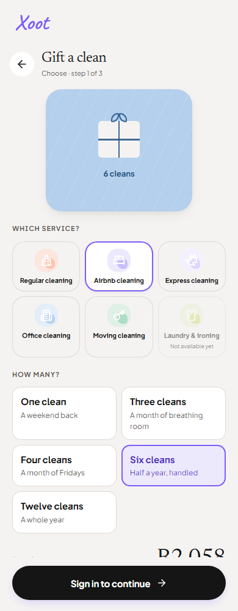

# Handoff preview checkpoint — 26 September 2026

Application commit: `438ace3c4697c797337e1f2fb8b30aeb9a0a069d`.
Vercel deployment: `dpl_5LiWeFihDDF5MWDB3EX2Vpu5GQ73`, READY and assigned to the stable
[development preview](https://xoot-git-codex-xoot-production-20260911-royal777-21s-projects.vercel.app/).
The preview is protected; use Vercel access or a current review link.

The older `xoot-hf65mhmfy` URL is an immutable deployment and does not receive branch updates.
Production remains on `02bb284`; this checkpoint did not promote or migrate production.

## Rendered website evidence

The hosted homepage, sign-in navigation, email/password controls and runtime checks passed.
Gift selection and the offline page passed at 320, 390, 768, 1024, 1440 and 1920 pixels with
no horizontal overflow or page errors. [Raw results](responsive-checks.json).
These checks do not assert that every remaining handoff screen is finished.

The images below were captured from the hosted preview, with fonts loaded and reduced motion.
They are screenshots of implemented pages, not generated concepts.

## Verification

- 125 test files and 1,274 tests pass locally, preserving the browser regression checks.
- Web/native type checking, lint, staging build, rendered artifact smoke, artifact scan and
  repository security guards pass.
- [GitHub Tests](https://github.com/ROYAL777-21/xoot-your-local-helpers/actions/runs/36266032079),
  [Semgrep](https://github.com/ROYAL777-21/xoot-your-local-helpers/actions/runs/36266032157),
  [Native iOS Swift check](https://github.com/ROYAL777-21/xoot-your-local-helpers/actions/runs/36266032126)
  and [readiness guard](https://github.com/ROYAL777-21/xoot-your-local-helpers/actions/runs/36266032147) pass.
  Those workflow names do not establish paid production readiness or native-device verification.
- Website full npm audit: zero advisories. Mobile: three moderate advisories in the
  `expo-router → query-string → decode-uri-component` chain, no high or critical advisories.
- Build warnings: the vendor bundle exceeds the size advisory. Native association files still
  require the actual Apple team identity and Android signing fingerprints.

## Remaining work

Gift requests need their reviewed migration and dependent functions delivered to staging before
real account submission can be verified. Paid gifting, recipient delivery/redemption and history
are unfinished. Server-authoritative booking quotes, crews, referral/payment fulfilment and the
remaining website/native source screens are still open in the
[production checklist](../../production-checklist.md) and
[visual coverage ledger](../../../implementation/visual-fidelity-ledger.md).

Native source checks are not screenshots or device tests. Automatic approval review rejected
starting the Expo preview, including localhost-only startup, with “blocked by policy” and no
further reason. No alternative startup path was used to bypass that rejection.

## Download this checkpoint

[Source ZIP](https://github.com/ROYAL777-21/xoot-your-local-helpers/archive/438ace3c4697c797337e1f2fb8b30aeb9a0a069d.zip)
requires access to the private GitHub repository. This is a development source snapshot.
The tagged production release, deployable release archive, APK/AAB and TestFlight delivery
remain separate, unfinished acceptance gates.
