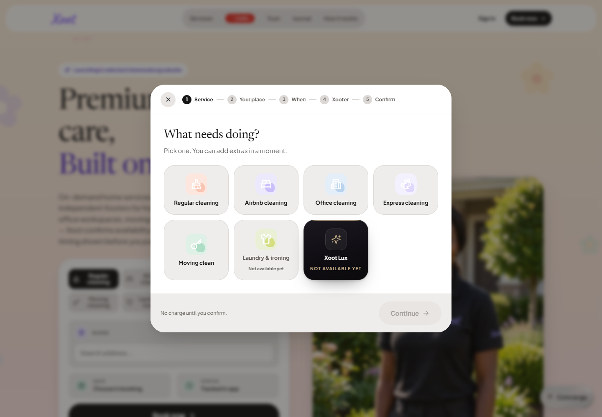
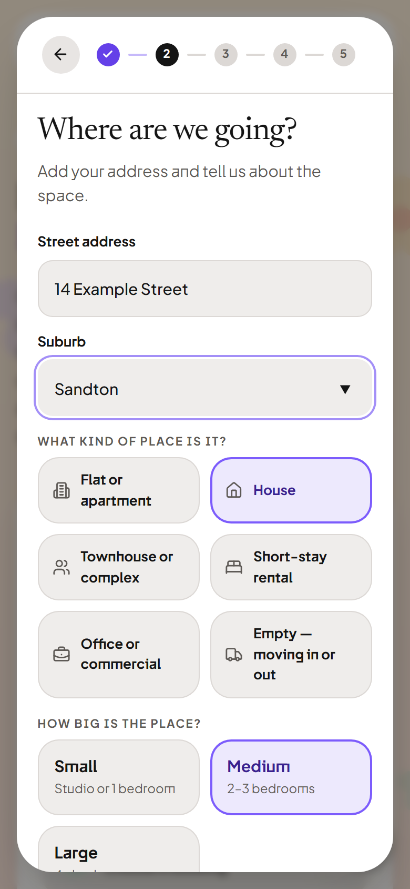

# Website booking checkpoint — 28 September 2026

Application commit: `0e3a57af3e5c9061e3067238feb59489e399f4a7`.
Vercel deployment: `dpl_94ib3kqgTLUAvAhzgbtCMFXaRmpg`, READY and assigned to the
[stable development preview](https://xoot-git-codex-xoot-production-20260911-royal777-21s-projects.vercel.app/).
The preview is protected; use authorized Vercel access or a current review link.

## Rendered website

The original website booking modal is now separate from the app booking layout. Service,
place, date/time, crew and review steps use real inputs, roster requests and the new server
quote interface. New crew prices cannot reach the old per-person booking writer.

All five steps passed at 320, 390, 768, 1024, 1440 and 1920 pixels plus 844x390 landscape.
Checks covered horizontal overflow, loaded heading font, no persistent panel transform,
keyboard focus containment and Escape dismissal. The 390px capture uses double density.
[Raw responsive checks](booking-responsive-check.json). Test addresses were entered only
into local drafts; no booking, payment or customer record was created by these screenshots.

## Verification and limits

- 130 files / 1,329 tests pass for the application checkpoint, plus seven native booking helper
  tests. Web/native typecheck and lint, staging build, rendered home/sign-in artifact smoke,
  artifact/security and lockfile guards pass. Scoped quote/client reviews pass.
- The R393 base + R39 fee example is covered by executable server/client contract tests.
  A signed-in staging quote journey and atomic creation/payment/crew fulfilment are not proven.
- Initial staging quote-function deployment [36384479422](https://github.com/ROYAL777-21/xoot-your-local-helpers/actions/runs/36384479422)
  stopped at a Docker registry download limit before upload. The reviewed workflow correction
  uses Supabase CLI server-side bundling. [Retry 36385184482](https://github.com/ROYAL777-21/xoot-your-local-helpers/actions/runs/36385184482)
  succeeded. Readback confirms `get-booking-quote` ACTIVE, version 1, with JWT verification enabled.
  Its real staging preflight permits the stable preview origin (204); an unsigned POST is denied
  (401). These checks do not replace the outstanding signed-in quote journey.
- The Web build workflow initially attempted browser tests before installing Chromium; that order
  is corrected. [Main Tests run](https://github.com/ROYAL777-21/xoot-your-local-helpers/actions/runs/36384480029)
  and Semgrep passed for this application commit. Fresh workflow results remain authoritative.
- Follow-up `3ec45f0` is also deployed: Vercel `dpl_6wacxcR2e2B6gi3pKeXdJXajfL7X`, READY.
  Its [Tests run](https://github.com/ROYAL777-21/xoot-your-local-helpers/actions/runs/36385188889)
  passed. The [Web build run](https://github.com/ROYAL777-21/xoot-your-local-helpers/actions/runs/36385188992)
  passes 131 files / 1,336 tests, build and artifact scanning, then correctly fails on a production
  backend CORS rejection from its local artifact origin. The corrected check renders the actual
  artifact at its configured public origin in an isolated browser, leaving external backend traffic
  real. That production-configured artifact passes locally without broadening production CORS.
  The required CI job must still pass after this correction is pushed.
- Hosted home/sign-in now pass on `3ec45f0`, including a direct `/auth` reload, email-code controls
  and password mode. The earlier hosted failure was an expired preview share link redirecting to
  Vercel login. [Fresh capture metadata](hosted-startup.json) and the [390px sign-in screenshot](website-signin-390.png)
  record the current deployment. No login or customer data was submitted.
- Eight browser regression tests pass. A new client-side navigation fixture first reproduced a
  false pass when the host returned 404 for direct `/auth`; explicit reload/status/control checks
  now reject it. Scoped source review, lint and website type checking pass.
- Private SQL calculator `3caef43a` passes eight checks including 1,332 complete SQL/TypeScript
  quote comparisons, malformed input and access controls. CodeRabbit and the immutable Codex
  Security diff review completed with zero findings for its two-file scope. This does not replace
  whole-release review. Booking SQL and gift rollback/access checks now have a required CI job;
  neither the calculator nor the new booking writer has been deployed to a database.
- [Production schema check](https://github.com/ROYAL777-21/xoot-your-local-helpers/actions/runs/36384483558)
  is correctly red: pending gift contract/referral structures are absent, with additional generated
  formatting/view placement differences. Do not overwrite expected new types merely to hide drift.
- [Claude security action](https://github.com/ROYAL777-21/xoot-your-local-helpers/actions/runs/36384483538)
  appeared green but its actual result was “Credit balance is too low”, not a completed scan.
  A new result guard rejects provider errors/missing output. Seven guard tests pass; 18 existing
  Edge configuration checks pass. The [new run](https://github.com/ROYAL777-21/xoot-your-local-helpers/actions/runs/36385188931)
  now fails instead of presenting that provider error as a successful review. Owner API funding
  is required to run that external reviewer.
- Native visual verification remains unfinished. Automatic approval review rejected Expo startup,
  including localhost-only startup, with “blocked by policy” and no further reason. No alternative
  startup path was used to bypass that rejection.

No production deployment or database migration occurred. The complete handoff scope, paid website
launch and native distribution remain open in the [production checklist](../../production-checklist.md)
and [visual coverage ledger](../../../implementation/visual-fidelity-ledger.md).

[Download this source checkpoint](https://github.com/ROYAL777-21/xoot-your-local-helpers/archive/0e3a57af3e5c9061e3067238feb59489e399f4a7.zip)
requires access to the private repository. It is not the final production release, APK or TestFlight build.
