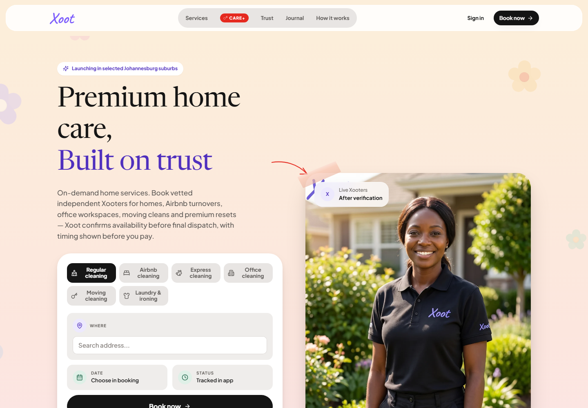
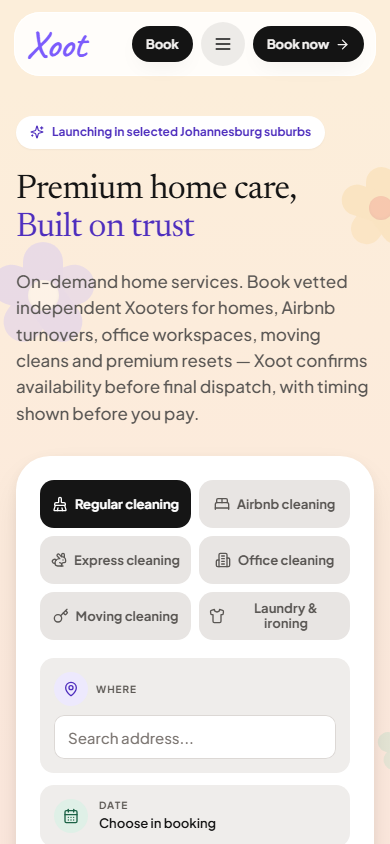

# Current published preview — 7 October

Captured at 17:24 UTC (19:24 SAST), from the actual protected Vercel preview, commit
`c80fd40d4942e5433141c9f0c38b84fd34c98797`. This precedes the uncommitted integration of main.

- Home and direct sign-in captured at 1440 × 1000 and 390 × 844.
- Real staging directory returned zero approved profiles before capture; no response interception
  or synthetic account records. Visible images decoded and fonts loaded before screenshots.
- No page/console errors, configuration overlay or horizontal overflow in these checks.
- The original logo, Newsreader display type and source homepage composition are retained.
- Public copy describes confirmed availability; no sample helper identity or instant-dispatch claim.

The build stamp still names the legacy ZD-026 rule. The separately implemented, approved ZD-038
shared quote does not establish that the unfinished crew booking writer and payments have cut over.
No complete signed-in or paid journey, complete handoff coverage, native app or production release
is certified by these public-page screenshots. See [integration preflight](../integration-preflight.md)
and the [production checklist](../../../production-checklist.md).

The stable preview requires authorized Vercel access or a temporary share link. Temporary link
tokens are intentionally absent from committed evidence. Measurements are in [evidence.json](evidence.json).

