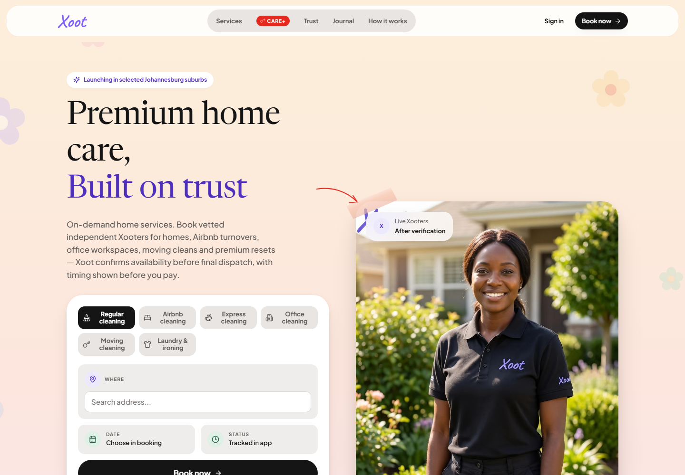
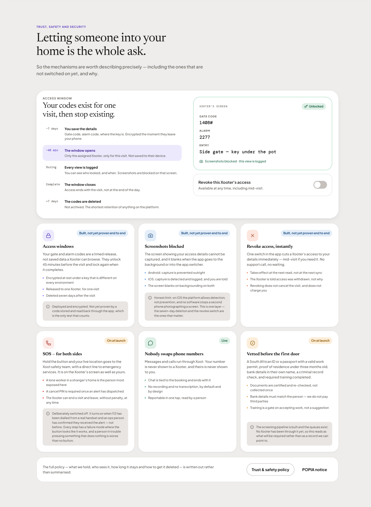
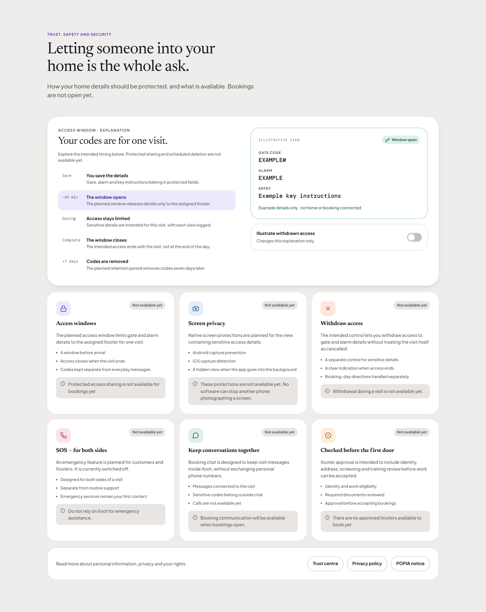
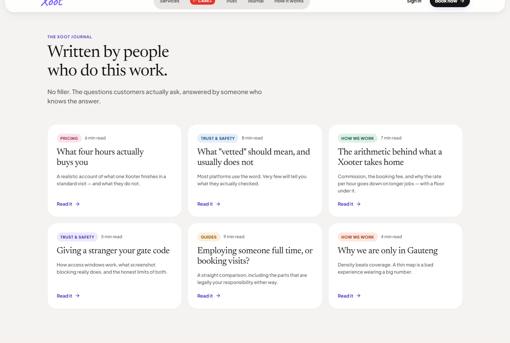
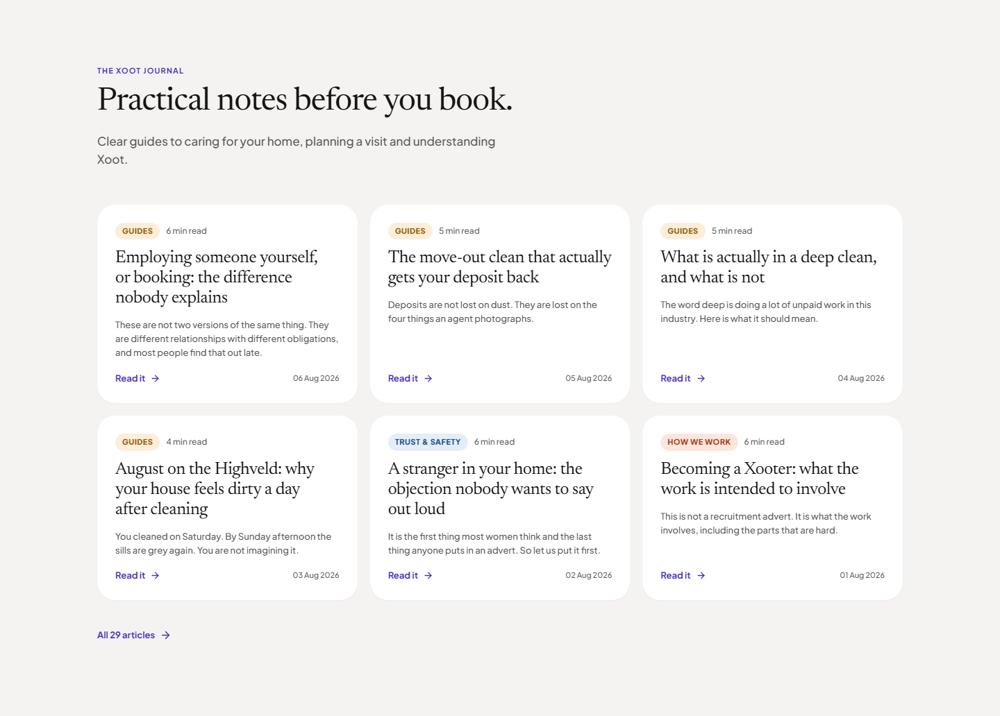
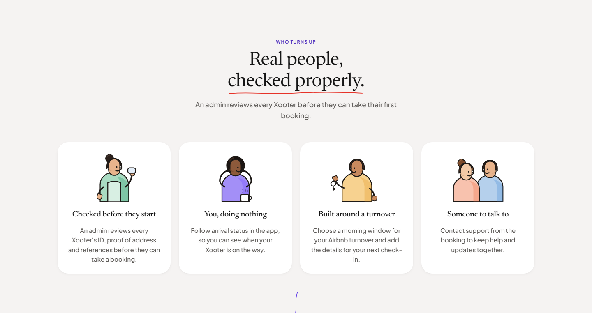
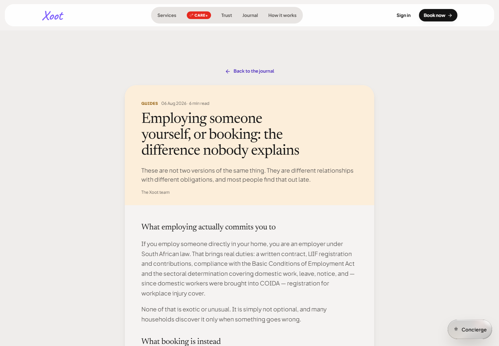
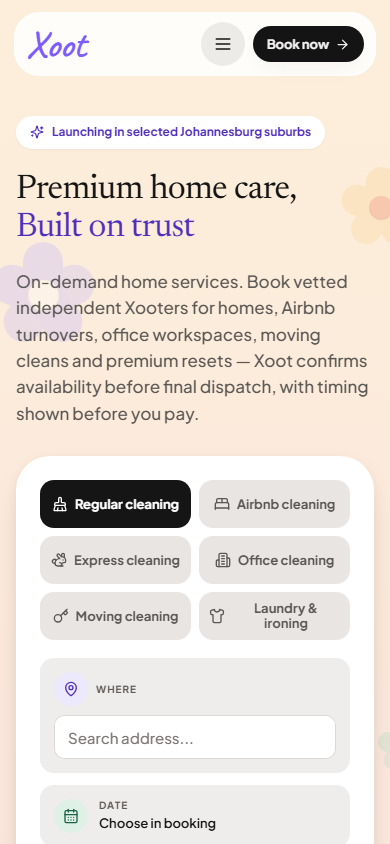
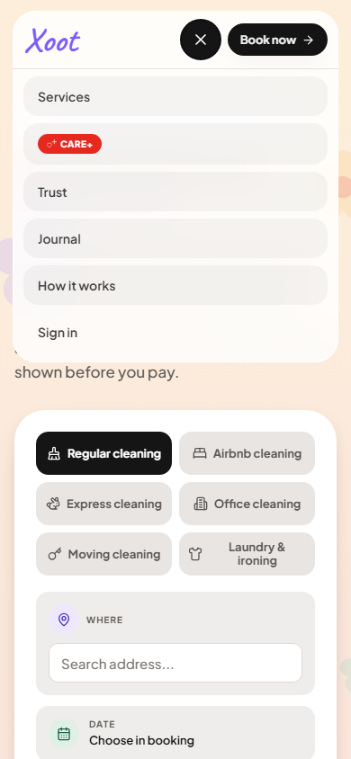
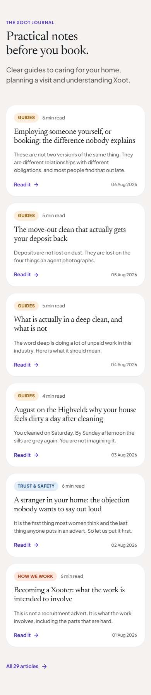

# Public website corrections — local verification, 14 October 2026

Source commit `6056b6f1e6aa531a0f3ec3b49281fcf4b27d218a` preserves the original
handoff logo, typography and artwork. It removes the duplicate public-navbar Book,
ports Trust and Journal/index/reader composition, connects real article routes and
corrects the original SVG sizing. Availability wording describes unverified services
honestly; the access timeline is explicitly an explanation, not a connected booking.

This is a **local staging-configured build**, not a production or hosted-preview update.
The last verified hosted preview remains `14cc5d5` from 8 October. The wider website,
native handoff, real paid journeys and company-wide readiness are unfinished.

| Verification | Result and evidence |
|---|---|
| Aggregate | [165 files / 1,749 tests pass](aggregate-serial.log); seven existing SQL-runtime skips. Files run sequentially with unchanged assertions/deadlines. |
| Previous timeouts | [Two-worker run](aggregate-complete.log) timed out in two unchanged history tests. [Both files](history-timeouts-focused.log) pass in isolation; the complete sequential run passes. The parallel timing limitation is retained. |
| Static checks | [Types, lint, lockfiles and source scans](checks-complete.log) pass. |
| Build and startup | [Build, rendered artifact and artifact scan](build-complete.log) pass; actual staging directory returns zero approved Xooters. |
| Responsive | [Seven viewport records](responsive-metrics.json): 320, 390, 768, 1024, 1440 and 1920px plus 844×390 landscape; no root overflow or runtime errors, one visible Book now, no duplicate Book. |
| Interaction | [21 checks](interactions.json) pass: mobile keyboard/menu, booking dialog, explanation stages/switch, Trust aliases, article index/detail/refresh/legacy aliases/read-next and unknown-slug recovery. |
| Sharpness and motion | [DPR2 desktop/phone and motion checks](density-motion.json) pass. Loaded fonts, vector characters, no persistent text transform/filter, hover transform clears. Original portrait is 1792×2400. |
| Source comparison | Original and revised Trust/Journal share typography, card/grid structure and responsive reflow. Real publication records and truthful availability replace prototype facts. See screenshots below. |

Independent source review and the 15 October evidence addendum approve this bounded
public task with no open defects. The managed risk assessment recommends merge with
human review; it does not authorize deployment or complete the company-wide review.

The [detailed QA record](qa-handoff.md) explains screenshot handling and prior diagnostic
attempts. Full-section screenshots retain viewport width but enlarge capture height so
the nested app scroll container can be captured correctly. Normal-size metrics are
recorded separately. The [original size measurements](reference-other-widths.json)
and [file checksums](manifest.json) preserve provenance.

The initial unknown-slug return probe observed the URL before React mounted the index.
The [retained observation](interactions-transition-observation.json) is not a hidden failure:
the completed check observes zero initial cards, then all 29 visible cards after 72ms.
No product change or test deadline increase was used to obtain the completed result.

The [earlier runner logs](browser-runner-transition-observation.log) and
[absent-server observation](responsive-server-absent.json) retain diagnostic attempts.
The Browser connection was unavailable. Playwright MCP and the repository's installed
Playwright runner supplied website evidence. A disappeared local server was confirmed
absent before restart. No native/Expo startup or hosted write was attempted.

Remaining gates include actual browser-menu zoom, physical devices, complete authenticated
customer/Xooter/admin journeys, all remaining handoff screens, schema/function delivery,
payments, operational commitments and the final security/functional review. Existing
booking availability copy elsewhere and the older build-info pricing-rule label also
remain on the final consistency checklist. See the [current production checklist](../../../production-checklist.md).

## Screenshots

Current local homepage: 

Original Trust: 

Revised Trust: 

Original Journal: 

Revised Journal: 

Original characters with corrected sizing: 

Working article page: 

Mobile homepage: 

Mobile menu: 

Mobile Journal: 
