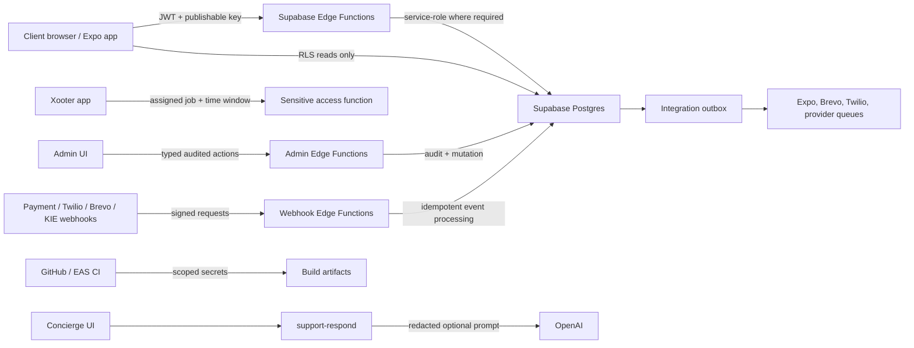

# Trust Boundary Map

Reviewed: 2026-07-02

## Boundary Rules

| Boundary | Untrusted side | Trusted side | Enforcement |
| --- | --- | --- | --- |
| Browser/Expo to Supabase | User-controlled client code, route params, local storage, deep links | RLS, JWT validation, Edge Function input validation | Publishable key only; ownership and role checks on every sensitive action |
| Xooter to household access | Contractor device and app state | `can_access_sensitive_data` and `get-sensitive-access` | Assignment, status, window, revocation, access log, no background persistence |
| Admin UI to operations | Admin browser and form inputs | Typed audited admin Edge Functions | Admin role, MFA expectation, reason, audit log |
| Provider webhook to Xoot | Internet requests and callback payloads | Webhook Edge Functions | Signature, timestamp/replay controls, idempotency, redacted errors |
| Concierge to model | User prompt and public app knowledge | Optional OpenAI answer | Redaction, no tools, no account mutation, escalation gates |
| CI/EAS to stores/providers | Build runner and artifact upload | Signing and deployment systems | Scoped credentials, protected environments, fail-loud config |
| Public website to SEO crawlers | Anonymous traffic and scrapers | Static content and safe public APIs | Public-only content, WAF/rate limit when domain exists, no private data in markup |

## Disallowed Crossings

- Public client directly writing admin queues, payment status, payout status, booking terminal states, or audit records.
- Any widget, push, email, SMS, WhatsApp, Live Activity, or assistant shortcut exposing gate codes, alarm codes, lockbox codes, private addresses, private notes, or payment secrets.
- Agents making live provider changes or production database repair without a human-approved local credential flow.
- Chat, docs, env examples, screenshots, or PR comments containing real private secrets.
